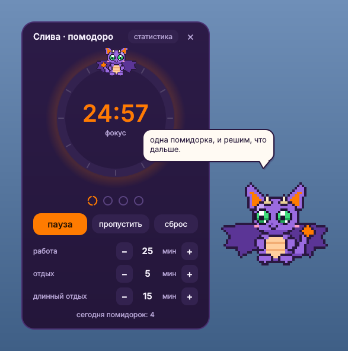
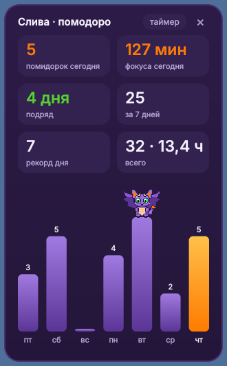

# Dragzy 🐉

**English** · [Русский](README.ru.md)

A tiny purple pixel dragon that lives on your Windows desktop, chats with you and keeps track of your pomodoros.






> The dragon speaks English and Russian: you pick the language on first launch and can switch it later in settings. All of his lines live in plain Python lists, so you can edit them or write your own.

## Features

- **Lives on your desktop.** Stays beneath your windows, flies around, flaps his wings, blinks, turns toward the cursor, sometimes chases it, and falls asleep on the taskbar when he gets tired.
- **Pomodoro timer.** Click the dragon to open the timer. It has work, short break and long break phases. You choose the lengths, how many pomodoros come before a long break (2-8), and whether to start with work or with a break. The timer remembers your settings. When a phase ends, a short chime plays and the dragon flies above all windows to tell you it's time for a break or time to get back to work.
- **Statistics.** A tab in the pomodoro window shows today's pomodoros and focus minutes, your day streak, your best day, all-time totals and a 7-day chart. Stats are saved to `%APPDATA%\Dragzy\stats.json` every minute and on exit, so nothing is lost if you close him mid-pomodoro.
- **Personality.** Smart and caring, but a troublemaker. He sometimes dodges your click (he gives in on the second try), leaves sticky notes on your desktop, hides behind the edge of the screen, sneezes fire, puts on sunglasses or an outfit of the day (beret, scarf, bow tie, tiny bag), throws a mini concert, gives you improv challenges, tells science jokes, flirts a little, and sits on top of the pomodoro window. During a work pomodoro he behaves himself. Pick the calm personality to turn the mischief off.
- **Chatter.** Every 7-13 minutes he says something in a speech bubble: about the time of day, the day of the week, a bit of motivation, or your personal topics.
- **Sounds.** Six chimes, all synthesized by the program itself: bell, marimba, harp, drops, soft gong, 8-bit, or no sound. Pick one with the arrows in the pomodoro window, it plays right away so you can hear it.
- **Weather.** Once a day he checks the forecast and gives advice like "rain tomorrow, take an umbrella".
- Drag him around with the mouse. Right-click opens a menu: pomodoro, statistics, "say something", "go to sleep", quit.

## Installation

**The easy way:** download `Dragzy.exe` from [Releases](https://github.com/skolkodetails/dragzy/releases/latest) and run it. No Python needed. Windows SmartScreen may warn you because the file isn't signed: click "More info" → "Run anyway".

**From source:** you need Python 3.9+ for Windows.

```bash
pip install -r requirements.txt
```

Then double-click `dragzy.pyw`. The `.pyw` extension keeps the console window from popping up.

## Getting acquainted

On first launch the dragon asks for your language (English or Russian), your name, how to address you (she / he / neutral), your city for the weather, what to call him, his size, his personality, **cheeky** (pranks, sass, sticky notes) or **calm** (just care and the timer), and whether to start him together with your computer. Everything is saved to `%APPDATA%\Dragzy\settings.json` and can be changed later via right-click → settings.

Want your own lines? Copy `personal.example.py` to `personal.py` and add them there. `personal.py` is listed in `.gitignore`, so it never ends up in the repository.

Other settings are at the top of `dragzy.pyw`:

| Setting | What it does |
|---|---|
| `DESKTOP_ONLY` | `True`: lives beneath your windows; `False`: flies above everything |
| `WEATHER` | `False`: no internet access at all |
| `PHRASE_EVERY_MIN` | how often he talks |
| `SIZE` | dragon size in real screen pixels: 2 small (default), 3 medium, 4 large. Also in settings |
| `SOUND` | `False`: no chimes at all (the sound itself is chosen in the pomodoro window) |

## Privacy and safety

- Uses only the Python standard library and Qt (PySide6).
- Goes online only for the weather, once a day, via Open-Meteo. No account needed. Your city's name is sent once to find its coordinates, after that only the coordinates.
- Writes only its own files in `%APPDATA%\Dragzy`: `settings.json` and `stats.json`. It adds itself to startup only if you choose so during setup (a small file in your user Startup folder, no admin rights), and it doesn't read your keyboard or the contents of other windows. All it knows about your system is the screen size and where the cursor is.
- CPU usage is about 3% of one core in normal mode and about 1% while he sleeps.

If the dragon doesn't show up after launch, set `DESKTOP_ONLY = False`: some Windows builds hide windows like this beneath the desktop.

## License

[MIT](LICENSE)
