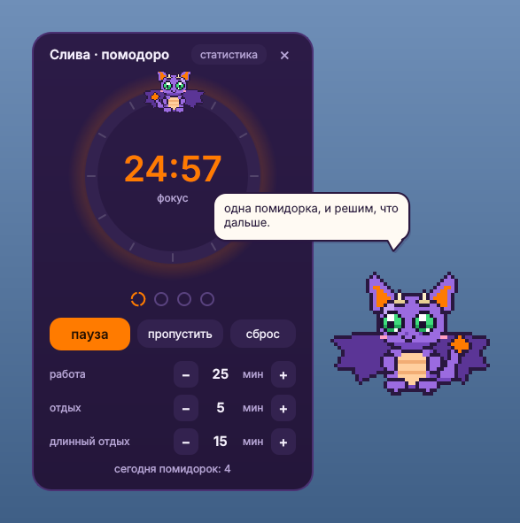
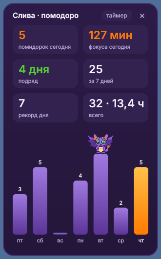

# Dragzy 🐉

[English](README.md) · **Русский**

Маленький фиолетовый пиксельный дракончик, который живёт на рабочем столе Windows, болтает и следит за помидорками.






## Что умеет

- **Живёт на рабочем столе.** Держится под окнами, летает, машет крыльями, моргает, поворачивается к курсору, иногда сам подлетает к нему, а уставший засыпает на панели задач.
- **Помодоро.** Клик по дракончику открывает таймер: работа, короткий и длинный отдых (после каждой 4-й помидорки), длительность настраивается. Когда фаза заканчивается, звучит короткий сигнал, и дракончик вылетает поверх всех окон с подсказкой «пора отдохнуть» или «пора работать».
- **Статистика.** Вкладка в окне помодоро: помидорки и минуты фокуса за сегодня, серия дней подряд, рекорд, всего, а также график за 7 дней. Хранится в `%APPDATA%\Dragzy\stats.json` и не теряется между запусками.
- **Характер.** Умный и заботливый, но хулиган: иногда уворачивается от клика (со второго раза сдаётся), оставляет записки на рабочем столе, прячется за краем экрана, чихает огнём, надевает тёмные очки, подмигивает, садится на окно помодоро. Во время рабочей помидорки ведёт себя прилично. Выключается выбором спокойного характера.
- **Фразочки.** Раз в 15-25 минут говорит что-нибудь в облачке: по времени суток, про день недели, мотивацию и твои личные темы.
- **Погода.** Раз в день берёт прогноз и даёт совет вроде «завтра дождь, возьми зонт».
- Его можно схватить мышкой и перетащить. По правому клику открывается меню: помодоро, статистика, «скажи что-нибудь», «уложить спать», выход.

## Установка

Нужен Python 3.9+ для Windows.

```bash
pip install -r requirements.txt
```

Потом запусти `dragzy.pyw` двойным кликом. Благодаря расширению `.pyw` окно консоли не появляется.

## Знакомство

При первом запуске дракончик спрашивает, как тебя зовут, как к тебе обращаться (она / он / без рода), твой город для погоды, как его назвать и какой у него характер: **нахальный** (проделки, дерзость, записки) или **спокойный** (только забота и таймер). Всё сохраняется в `%APPDATA%\Dragzy\settings.json`, поменять можно потом: правый клик по дракончику, «настройки».

Хочешь свои фразы? Скопируй `personal.example.py` в `personal.py` и допиши их туда. Файл `personal.py` указан в `.gitignore` и в репозиторий не попадает.

Остальные настройки лежат в начале `dragzy.pyw`:

| Настройка | Что делает |
|---|---|
| `DESKTOP_ONLY` | `True`, живёт под окнами; `False`, летает поверх всех окон |
| `WEATHER` | `False`, совсем без интернета |
| `PHRASE_EVERY_MIN` | как часто он говорит фразочки |
| `SOUND` | сигнал в конце помидорки |

## Безопасность

- Используются только стандартная библиотека Python и Qt (PySide6).
- В интернет ходит только за погодой, раз в день, через Open-Meteo. Аккаунт не нужен. Название города отправляется один раз, чтобы найти координаты, дальше только координаты.
- Пишет только свои файлы в `%APPDATA%\Dragzy`: `settings.json` и `stats.json`. Не ставится в автозагрузку, не читает клавиатуру и содержимое окон. О системе знает только размер экрана и где курсор.
- В обычном режиме нагрузка около 3% одного ядра процессора, во сне около 1%.

Если после запуска дракончик не виден, поставь `DESKTOP_ONLY = False`: некоторые сборки Windows прячут такие окна под рабочим столом.

## Лицензия

[MIT](LICENSE)
